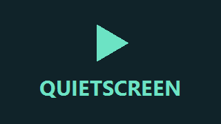

  

  <strong>YouTube videos, made for your TV remote.</strong> 
  An independent player for Android TV and Google TV. No account required.

  <a href="https://github.com/LocalCiggyShop/Aprion-TV/releases"><strong>Download Aprion TV</strong></a>
  &nbsp;&bull;&nbsp;
  <a href="#features">Explore features</a>

---

## Watch on the big screen

Aprion TV lets you discover, search and watch public YouTube videos through a native TV interface. Browse by genre, explore a creator's uploads or pick up an unfinished video, all with your remote.

Built for **Android TV and Google TV running Android 8.0 or later**.

## Features

| | What you can do |
| :--- | :--- |
| **Browse & discover** | Explore eight genre rows and personalised recommendations. Video cards show upload age and available view counts. |
| **Search** | Find videos and sort loaded results by newest first or relevance. Load more results as you browse. |
| **Channel browsing** | Open a creator's regular uploads, browse older videos and return to the same channel after playback. |
| **Continue watching** | Resume unfinished videos from saved playback positions. |
| **Native playback** | Use remote controls to play, pause and choose available video quality and audio tracks. |
| **Preview seeking** | Hold Left or Right to choose a position, then press OK to seek or Back to cancel. Preview images appear when available. |
| **Video chapters** | While seeking, press Up to snap between available chapters with Left/Right. Down returns to time seeking; OK confirms and Back cancels. |
| **Autoplay** | Continue to a recommended video after a 15-second countdown, with Play now and Cancel options. Autoplay can be turned off. |
| **Tune recommendations** | Choose More like this, Not interested or Don't recommend this channel. Pause learning or reset your preferences in Settings. |
| **In-app updates** | Check for updates in Settings. Updates are checked and downloaded while Home or Settings is open, with signature verification before installation. Android may require approval. |

## Your preferences stay on your device

Aprion TV has **no sign-in, analytics or ad SDK**. Recommendation preferences, feedback and resume positions are stored locally. Search queries and catalog results stay in memory.

When personalisation is enabled, discovery may send up to two learned topic words to YouTube. Stored viewing lists, feedback and preference scores are not uploaded. Video requests contact YouTube and its media servers; update requests contact GitHub.

## Good to know

- Captions are currently unsupported.
- Search sorting applies to loaded results, rather than every matching video on YouTube.
- YouTube changes can interrupt browsing or playback; ad-free playback is not guaranteed.

---

**Independent project.** Aprion TV is not affiliated with, endorsed by or sponsored by YouTube or Google. YouTube and Google are trademarks of their respective owners. Videos, thumbnails and other content belong to their respective rights holders.

Licensed under [GPL-3.0-or-later](LICENSE). See [third-party notices](NOTICE.md).
